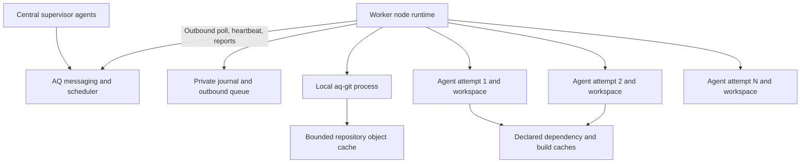

# Agent Q worker framework design

**Status:** Draft for review  
**Date:** 2026-10-30  
**Implementation language:** Rust  
**Repository:** `aq-worker`  
**Related contracts:** [Agent Q foundation](../../../agent-q/docs/specs/0001-infrastructure-foundation.md), [aq-git](../../../aq-git/docs/specs/0001-aq-git.md), [aq-graph integration](../../../aq-graph/docs/aq-integration.md)

An Agent Q worker node supplies compute and temporary workspaces for a configured number of agents. It runs as a container on a desktop or cloud machine and initiates all communication with the central daemon. The central system schedules work and hosts supervisor agents. The worker runtime accepts specific execution assignments, manages local capacity and files, delivers messages to agents, and reliably reports outcomes.

Capacity is shared across eligible projects. A project being eligible for a node does not allocate a worktree, reserve an agent slot, or download its repository. Workspaces are created on demand; reusable project data occupies a bounded cache. This is the primary mechanism for supporting many projects without multiplying idle workspaces across the fleet.

The canonical cross-component lifecycle is [AQ execution and recovery](../../../agent-q/docs/architecture/0002-execution-and-recovery.md). The [worker execution and agent-access supplement](0002-execution-and-agent-access.md) adds requirements W17–W21 and acceptance T21–T28 for launch recovery, scoped agent API access and protocol publication. [Ecosystem and releases](../../../agent-q/docs/architecture/0001-ecosystem-and-releases.md) defines repository and product assembly ownership. This framework's capacity, storage and confinement rules remain applicable.

## 1. Decisions and requirements

| ID | Requirement |
| --- | --- |
| W1 | Supervisor agents run centrally and address worker agents through AQ messaging. No supervisor agent or supervisor credentials are required inside a worker node. |
| W2 | All central-to-worker directives arrive in responses to outbound worker requests. Workers expose no inbound network listener and need no tunnel. |
| W3 | Execution slots are node-wide capacity, allocated across compatible projects; there is no project-by-slot preallocation. |
| W4 | Placement respects explicit project/node eligibility, available environments, resource limits, and local folder grants. |
| W5 | The node makes the final local admission decision using current reservations, available resources, and disk headroom. |
| W6 | Workspace confinement is configured through the selected harness by default; external folders require explicit grants. This baseline does not claim hostile-process isolation. |
| W7 | Repository data is reused through aq-git; mutable execution workspaces are independent and created on demand. |
| W8 | Active and unacknowledged work is protected from automatic cache eviction. Disk pressure may refuse work but cannot justify silently deleting it. |
| W9 | Offers, acceptances, execution reports, directives, and artifact handoffs have explicit identity, acknowledgement, replay, and recovery behavior. |
| W10 | Node liveness, execution authority, local process state, durable source handoff, and task completion remain distinct facts. |
| W11 | Every real agent CLI runs in an attempt-owned tmux host; Codex CLI, Claude Code, Gemini CLI and OpenCode each require explicit adapter qualification for product acceptance. |
| W12 | The worker is independently released and tested, with no AQ database or source-tree dependency and no new broker or database service. |
| W13 | Scheduling explains eligibility, placement, refusals, and cache decisions; ordinary polling performs no fleet-wide Git or filesystem scan. |
| W14 | Slot reclamation requires stopped execution writers. Workspace deletion additionally requires safe checkpoint/handoff and explicit retention release. |
| W15 | Capacity, preparation concurrency, pending-result storage, and cache budgets are bounded separately. |
| W16 | Foundation identity and heartbeat behavior remain compatible through a planned extraction; execution extensions do not silently change protocol v1. |

Fixed baseline choices are Rust, a containerized Linux worker, one lightweight node runtime, outbound HTTPS polling, central supervisor agents, agent-configured workspace confinement, explicit project eligibility, demand-created workspaces, bounded caches, and aq-git for code operations. No Kubernetes, message broker, database server, Docker-in-Docker, or host Docker socket is required for normal worker execution.

## 2. Ecosystem ownership

| Component | Owns |
| --- | --- |
| Central AQ daemon | Node enrollment/authorization, project policy, scheduling, assignment authority, resolved profiles, messaging, durable accepted results, workflow decisions |
| Central supervisor agents | Planning, guidance, review, and decisions through authorized AQ commands/messages |
| aq-worker runtime | Capacity reservations, local process lifecycle, harness configuration, polling, local journal, logs, artifact transport, local storage policy |
| aq-git | Git objects, exact revisions, private workspaces, checkpoints, bundle import/export, retention, repository-cache eviction |
| aq-graph | Tasks, dependencies, knowledge, and planning history; accessed through the central integration policy |
| Harness adapters | Configuration validation, process/session launch, input delivery, result interpretation, and optional safe reattachment |
| Execution adapter | Process ownership, resource observations, termination, and the declared confinement/containment capabilities |

The term **node runtime** denotes ordinary software, not an AI supervisor. It executes a resolved assignment and deterministic lifecycle policy. It does not decompose tasks, select new tasks from aq-graph, choose models, infer permission grants, or publish to shared source-control branches.

Harness and execution adapters are modules in this repository initially. Versioned interfaces allow later extraction without requiring it. Agent Q consumes a published worker protocol; the worker calls aq-git through its public process interface. No component reads another component's private metadata files.

## 3. Node topology and local dependencies



A worker image contains the aq-worker binary, its compatible aq-git binary, Git, tmux for every real agent CLI, and the harnesses/toolchains intended for that node class. Lightweight images for different project families are encouraged. Every node does not need every toolchain or project dependency. Environment selection uses capabilities; automatic rebuilding of arbitrary images is outside the baseline.

The node has persistent storage for its identity, journal, retained work, and caches. Container replacement preserves that volume. Ephemeral deployments may use disposable storage only when their operating policy accepts loss of work that has not reached central retention. Node destruction is not a substitute for normal drain and handoff.

The host/container operator installs external folder mounts explicitly. Assignments select declared mount aliases; they cannot cause the worker to mount arbitrary host paths. The worker has no host Docker socket by default. Projects requiring additional capabilities, such as nested container builds, must be routed to an explicitly configured node class rather than silently broadening all workers' access.

Initial support targets Linux containers, including containers hosted through the existing desktop/WSL arrangement. Native Windows and macOS runtime semantics are future work. Local development can run the same binary as a process with a fake coordinator; container requirements must not slow every core test.

## 4. Identity, configuration, and authority

### 4.1 Node identity and process incarnation

Reuse foundation enrollment and the stable node identity. Each runtime start also creates a `boot_id` identifying this process incarnation. Requests include node identity, boot ID, protocol version, and software/capability versions. A restored or copied credential must not allow two independent runtimes to act as one node concurrently. The daemon registers one active incarnation and refuses conflicting registration unless an explicit replacement/recovery flow authorizes it.

An incarnation change is a reconciliation boundary, not permission to relaunch every journaled attempt. Existing attempts are matched against central generation, local process evidence, and artifact state. Assignment grants bind the node and active incarnation; a new incarnation needs explicit renewed authority before continuing work.

### 4.2 Configuration ownership

Central project/pool policy defines eligible node groups, required environments, routing priorities, allowed harness/model configurations, and execution budgets. Node-local configuration defines physical limits, installed capabilities, allowed projects/groups, available mount aliases, local credential profiles, and storage budgets.

Effective eligibility is the intersection of central policy and node-local permission. A central assignment cannot raise the local CPU/memory/slot ceiling or grant access to an undeclared directory. Local operator drain/disable restrictions remain effective even if central desired state says resume. Report all contributing restrictions so the effective state is explainable.

Follow the vault convention for editable nonsecret configuration. Worker deployments receive a versioned, validated node configuration; they do not need a live mount of the central vault. Resolved execution configuration includes a digest and remains fixed for an attempt. Updating a profile changes future assignments unless an explicit supported directive changes a running session.

### 4.3 Credentials

Workers retain only node authentication and execution credentials appropriate for their workloads. They do not hold central supervisor credentials, arbitrary administrative API credentials, or shared-branch publication credentials. Node credentials authorize only that node's polling, observations, assigned artifact transfers, and result reports.

Provider credentials required by an agent are selected through a configured local profile or a scoped provisioned mechanism. They are never embedded in ordinary assignment JSON, task descriptions, logs, or cache manifests. Per-attempt AQ credentials, where needed for agent commands, authorize that session's permitted operations and expire/revoke independently of node identity. They do not expose the worker's node credential.

## 5. Agent confinement and external folders

The baseline configures each harness to work within its assigned workspace. The node runtime supplies working directory, allowed roots, approval settings, and relevant tool restrictions using a tested harness adapter. A harness unable to represent the requested policy is ineligible; the worker must not silently fall back to unrestricted operation.

Extra access is expressed as mount-alias grants with explicit read-only or read-write intent. For example, an assignment can request read-only access to a locally configured dataset alias. Both central project policy and node-local configuration must permit it. Resolved physical paths are local facts; the daemon does not invent paths on the host. Conflicting writable access to a shared external resource can require an exclusive resource reservation keyed by the alias.

Harness configuration is the initial confinement mechanism. It is not claimed to be OS isolation against arbitrary malicious code or a bypass through an unrestricted shell. Do not advertise a node as a hostile-code sandbox merely because the node itself runs in a container. Stronger per-attempt isolation can later be added as an advertised execution capability without changing the placement protocol.

Runtime state, node credentials, and aq-git's private socket/object store are excluded from agent-visible grants. Supervisor secrets are absent entirely. Where ordinary process users and filesystem permissions provide an additional boundary, use it; the baseline must still describe its actual guarantees. Git may need internal read access to borrowed objects while the agent's tools remain confined to its worktree. The chosen harness/execution adapter must test that combination and report unsupported configurations.

## 6. Capacity model

### 6.1 Three independent resources

| Resource | Allocation and lifetime |
| --- | --- |
| Execution capacity | Node-wide maximum agents plus CPU/memory/resource budgets; reserved for an accepted attempt |
| Project residency | Git objects, immutable dependency material, and declared caches; retained within disk budgets while useful |
| Attempt workspace | Independent writable checkout/scratch area; created on demand and retained until safe retirement |

A node with eight agent slots and ten eligible projects supports eight concurrent slot reservations, not eighty preallocated checkouts. Slot IDs are local accounting aids; they are never stable agent addresses or permanent project ownership.

Capacity includes `max_agents`, CPU admission units, memory admission bytes, storage headroom, preparation concurrency, upload concurrency, and optional exclusive resources. Assignment resource requests are explicit; node defaults may fill missing estimates before acceptance. Slot count is a hard runtime admission limit. CPU/memory reservations are scheduling accounting unless the execution adapter advertises actual OS enforcement. Report observed use and enforcement capability separately.

The runtime itself, aq-git, transfers, and monitoring require reserved node headroom. Allocating all advertised memory to agents is invalid. Larger agents can consume more than one configured capacity unit while still occupying one session; the placement decision must satisfy all resource dimensions.

### 6.2 Reservation lifetimes

An accepted assignment reserves its execution capacity, estimated disk growth, and exclusive resources before preparation begins. Preparing assignments count against the slot ceiling, preventing unbounded prefetch queues. A separate preparation limit controls concurrent downloads/checkouts/dependency materialization. Baseline nodes do not speculatively accept an unlimited backlog to keep all future work local.

Execution reservations are released only after owned execution writers are confirmed stopped. Collection/transfer uses separately bounded I/O and CPU budgets. An attempt awaiting central acknowledgement may retain workspace bytes and a pending-result reservation without consuming an agent slot.

Bound pending-result count and bytes. If the central endpoint is unavailable and protected results accumulate, stop accepting work when that bound or the disk reserve is reached. Free agent slots alone do not establish eligibility for another assignment.

### 6.3 Advertised inventory

Heartbeat/poll inventory includes capacity totals and reservations, execution counts by phase, preparation/upload use, available filesystem bytes, managed storage by class, project residency summaries, toolchain/harness capabilities, and local pressure/drain reasons. Inventory has a monotonically increasing generation within a boot ID and an observation timestamp.

The daemon treats inventory as an estimate for placement. The worker rechecks current local state atomically when accepting an offer. An old advertisement can produce a routine refusal without corrupting scheduling state.

## 7. Project eligibility and environment residency

Project policy may specify allowed node IDs or administrator-controlled node groups, required environment IDs/toolchains, allowed harnesses, confinement requirements, required folder grants, minimum resources, and location restrictions. Node-reported labels cannot grant membership in a privileged group without central operator approval.

Distinguish eligibility from residency:

- **Eligible:** policy and capabilities permit this project.
- **Cold:** eligible, with no reusable local project data.
- **Preparing:** data/environment is being materialized for accepted work.
- **Warm:** reusable data is available locally.
- **Active:** one or more reservations currently need it.
- **Evictable:** no protected users or results depend on the data and it is reconstructible.

Warmth is also versioned. A dependency cache for one lockfile or toolchain is not warm for another. Advertise the relevant environment/configuration digest and approximate preparation cost, not a single permanent `project_installed` flag.

Environments describe immutable node/image capabilities plus an optional project preparation recipe selected by policy. Installing system packages or changing node-global configuration during ordinary assignment preparation is outside the baseline. Project preparation may populate declared dependency caches/workspace-local dependencies under the same execution limits and grants. Its command, version, inputs, expected storage, and failure status must be explicit; arbitrary instructions inferred from a repository cannot silently expand access.

## 8. Central placement and local admission

### 8.1 Eligibility filter

The central scheduler first filters by project policy, active node incarnation, protocol/capabilities, accepting/drain state, compatible environment, grants/exclusive resources, and reported resource headroom. A cold cache is not an eligibility failure if preparation fits the budget. An offline node cannot receive new authority.

### 8.2 Placement order

Use a deterministic, explainable baseline rather than an opaque optimizer:

1. Order runnable work using central task/pool priority and aging; worker nodes do not decide task priority.
2. Among compatible nodes, estimate earliest start from available capacity, queued local preparation, and environment materialization.
3. Prefer reuse of compatible local Git/dependency data when expected start times are comparable.
4. Avoid nodes close to disk/memory pressure or repeatedly failing this preparation.
5. Break remaining ties using fair distribution and a stable deterministic rule.

Warm affinity cannot override hard limits, permissions, or indefinitely starve another project. Waiting work gains priority; an idle eligible cold node may prepare a project when waiting for a warm node would be more expensive. Keep cost estimates simple initially, using observed preparation times/bytes and conservative defaults for unknown projects. Report uncertainty rather than inventing precise estimates.

Pools centrally specify selection, per-project or per-profile concurrency, and fairness. They do not create permanent node-local project slot banks. Optional keep-warm policies reserve a bounded cache budget, not execution slots. Fleet-wide cache-placement optimization, automatic node provisioning, and migration of running sessions are later work.

### 8.3 Example

| Node | Shared agent capacity | Eligible projects | Warm projects |
| --- | --- | --- | --- |
| Desktop | 6 | A, B, C | A, B |
| Cloud | 4 | B, C, D | C |

Project B usually benefits from the desktop cache. If the desktop is full, the scheduler can offer B to the cloud node, which reserves disk and prepares B only when it can safely do so. Project D cannot run on the desktop. Neither node allocates workspaces for idle eligible projects.

### 8.4 Admission outcomes

The worker atomically accepts or declines an offer after validating its binding/generation, current capacity, grant support, disk estimate, and local restrictions. Declines carry stable reasons such as `capacity_changed`, `disk_reserve`, `environment_unavailable`, `grant_denied`, `preparation_backlog`, or `draining`, plus updated inventory. A decline is not an execution failure.

An offer reserves the central scheduler's intent but cannot launch an agent. The worker persists a tentative local reservation and sends an idempotent acceptance. Only an acknowledged central execution grant permits preparation/execution. If acceptance's response is lost, retry/query the same acceptance; do not launch speculatively. A tentative reservation can expire locally before a grant is used, in which case the worker reports release and refuses a late response. The daemon must resolve that assignment rather than treating its prior grant as proof of a running process.

## 9. Disk budgets and cache policy

### 9.1 Storage classes

| Class | Examples | Automatic reclamation |
| --- | --- | --- |
| Protected active | Running/preparing workspace, required objects, borrowed Git base, reserved external resource | Never while in use |
| Protected pending | Unsubmitted checkpoints, results awaiting central retention/acceptance, interrupted work, unresolved operations | Never based only on age, task state, or node liveness |
| Reusable | Reconstructible Git cache, immutable dependencies, safe compiler cache entries | Within eligibility, dependency, and budget rules |
| Disposable | Acknowledged retired workspaces, unreferenced scratch, failed temporary download with no owning operation | Reclaim promptly through the owning component |

Classification is based on retained references and explicit lifecycle facts. A directory's modification time is not sufficient evidence that it is safe to delete.

### 9.2 Accounting and admission

Configure an overall managed-storage limit, a minimum filesystem free-space reserve, optional per-project cache ceilings, and a pending-result bound. Account for downloads, unpacking, checkouts, expected dependency/build growth, and logs in addition to Git object size. Existing active bytes and accepted reservations are counted together when admitting new work.

Use both component ledgers and observed filesystem free space. Shared objects/hardlinks must not be charged as fully duplicated bytes to every workspace. Attribute shared bytes to the owning repository/cache and report approximate accounting where the filesystem cannot expose exact exclusive allocation. Reconcile ledgers with bounded background scans; do not run a full `du` or Git scan on every heartbeat.

The admission budget is not a filesystem quota. External host writes and unexpectedly large builds can still consume disk. Advertise whether hard storage quotas are available; react to pressure even when estimates were wrong. Reserve enough space for small critical journal/report writes and define an ENOSPC path that preserves existing records and stops new allocation rather than overwriting them.

### 9.3 Reclamation policy

Use hysteresis: a high-water condition triggers reclamation toward a lower target, while an absolute free-space reserve blocks new preparation immediately. Concrete thresholds are node configuration, with validation that the low target is below the high threshold and that configured protected/keep-warm reservations fit the budget.

Reclamation order is:

1. Unowned temporary files and acknowledged workspaces eligible for retirement.
2. Unused workspace-local build outputs explicitly classified disposable by project policy.
3. Reconstructible cache entries with no active users, ranked by low expected reuse and bytes recovered relative to rebuild cost.
4. Unused project repository caches through aq-git's guarded cache-eviction operation.

Start with bounded least-recent-use plus measured rebuild cost, avoiding a new predictive subsystem. Coalesce preparation for the same immutable cache key. Track recent eviction/refetch cycles and back off admission or adjust placement to avoid thrashing. Keep-warm pins are budgeted preferences with explicit priority; they cannot consume the emergency reserve or override protection of actual work.

If only protected data remains, report `storage_blocked`, stop accepting work, and continue heartbeats, uploads, and cleanup that can safely release data. The system must surface the owning attempts/receipts preventing reclamation. It must not convert protected data into disposable data simply to meet a quota.

### 9.4 Cache sharing rules

Git objects are shared locally through aq-git with retention protecting borrowed histories. Dependency entries are keyed by project/trust scope, environment/toolchain digest, lockfile/input digest, platform, and preparation-recipe version as applicable. Sharing across projects is disabled unless the cache format and trust policy explicitly support it.

Immutable dependency artifacts or concurrency-safe compiler caches may be reused. Writable dependency/build directories are per-attempt unless the tool's tested contract permits sharing. Copy-on-write optimizations are optional filesystem capabilities; correctness cannot require them. A generic `node_modules` or `target` directory shared writable by every agent is not the default.

External folder grants are never treated as managed cache roots and never recursively reclaimed by aq-worker. Project cleanup recipes may delete only owned declared outputs, run with bounded permissions, and cannot erase checkpoints or runtime metadata.

## 10. Workspace lifecycle and aq-git contract

Allocate a workspace only for an accepted, authorized attempt. Code assignments call aq-git to ensure base objects and create a private checkout at an explicit OID. Non-code assignments use a private scratch directory with the same ownership/retention rules. No live workspace or agent context is reused across attempts in the baseline; only safe caches are reused.

Runtime states and Git records are coordinated through stable operation IDs. A retry after a lost response asks aq-git for the same operation; it does not allocate another checkout. The worker stores the returned workspace ID/generation and repository binding identity. It never writes aq-git's private journal or deletes its pool directly.

On completion or cancellation, stop workspace writers, checkpoint any work requiring preservation, export source, upload it, obtain central retention, and report the attempt outcome. Running-process termination, source preservation, artifact acceptance, and local retirement are separate steps. Dirty or uncertain workspaces remain protected and visible even when their original task is no longer active.

Workspace retirement uses aq-git's expected-generation/HEAD checks and requires an appropriate retained checkpoint. Releasing local checkpoint/transfer handles additionally requires the worker's durable evidence that required content is retained centrally or an explicit operator discard decision. Neither task completion nor a heartbeat timeout supplies that evidence.

Efficient node cache management requires `aq-git repo cache-evict`. It must retain repository registration and historical operation records while evicting only disposable local repository material after verifying no active/borrowing workspace, live retention handle, unresolved mutation, export/import, or reader depends on it. The next preparation rehydrates the pool from the central artifact source. The worker must not implement this by deleting `.git` directories. This contract is tracked in the [aq-git design](../../../aq-git/docs/specs/0001-aq-git.md).

Potential preprepared workspace pools are deferred until preparation measurements justify them. Any later pool has a node-wide disk/count limit, freshness checks, and demand-based allocation; it cannot recreate a project-count times slot-count allocation model.

## 11. Assignment and execution lifecycle

### 11.1 Identifiers and resolved execution spec

Use distinct stable IDs for offer, acceptance request, attempt, execution session, assignment generation, node, boot, report, message, and artifact. A task may have several attempts over time; an attempt has at most one authorized active node assignment generation. A session ID addresses the actual agent conversation and is never derived solely from a reusable slot number.

A resolved execution spec contains:

- Attempt/session identity, assigned node/incarnation, assignment generation, and execution grant.
- Project identity, resolved profile/configuration digest, harness/model settings, instructions/context references, and outcome contract.
- Repository binding/base OID or scratch-workspace requirements.
- Required environment digest, preparation recipe, and resource/storage estimates.
- Explicit folder-alias grants, credential-profile references, and allowed session API capabilities.
- Run timeout, cancellation behavior, artifact destinations, and retention/reporting requirements.

The worker validates the complete spec before acceptance. Strings in instructions cannot override typed resource/grant fields. Secrets are references rather than values in ordinary payloads. An assignment whose environment or permissions cannot be represented by the adapter is declined, not run under a broader default.

### 11.2 States

```text
offered → reserved → authorized → preparing → running
                                          ↓          ↓
                                        stopping ←───┘
                                          ↓
                                       collecting → reporting → acknowledged → retired
```

An offer can be declined or expire before authorization. A preparation failure may enter collecting directly if no process writers remain. A successful agent exit also requires a stop/quiescence check before collection. Outcome is a separate field: `succeeded`, `failed`, `cancelled`, `interrupted`, or `unknown`. A lifecycle phase is not an assertion about code integration or task completion.

Persist enough intent before each external action to distinguish never-launched, launch-uncertain, running, stopped, and unacknowledged results after a crash. A crash between process spawn and storing its identity must not trigger a blind relaunch. Use an attempt-owned launch identity and discoverable process/session metadata; classify uncertainty when reattachment cannot be proven. PID alone is not a durable process identity because it can be reused.

Initial execution is one agent session per attempt. Reusable chat sessions, hibernation, and migration of a running session between nodes require later contracts. Repository/environment reuse does not carry prior prompts, provider tokens, or mutable working files into a new attempt.

### 11.3 Leases and disconnects

Node heartbeat liveness and attempt authorization have different timeouts. Retain the foundation defaults of a 15-second heartbeat and offline classification after 60 seconds unless configured otherwise. Offline classification prevents new placement and informs the UI; it neither deletes node identity nor proves an execution stopped.

Execution grants carry a sequence, assignment generation, and renewable validity duration. Initial proposed validity is 120 seconds with renewal attempted every 15 seconds, independently of uploads/preparation. These are pilot defaults, not fixed protocol constants. The local deadline must conservatively account for request/response delay and use a clock that advances across host suspend. A late renewal response cannot extend an expired or superseded grant. After runtime restart or clock uncertainty, obtain a new explicit grant before continuing an attempt.

When a renewal cannot be obtained before the local deadline, stop the execution according to its adapter, preserve work, and report when connectivity returns. Do not start another attempt while still uncertain whether old writers are active. A disconnected desktop can therefore retain work without retaining indefinite authority to perform new external actions.

The central daemon does not treat lease expiry as proof that external side effects did not happen. It records the old attempt as interrupted/uncertain and applies retry policy explicitly. Generation checks prevent stale reports from completing newer attempts; they cannot undo an external action already performed. Exactly-once agent execution or external side effects are not promised.

Revocation or a definite invalid-credential response stops acquisition and requests termination of active work. A node unable to upload after revocation retains local evidence for an authorized recovery procedure. It never switches to an unauthenticated endpoint. There is no claim of instantaneous remote termination while a node is disconnected.

## 12. Outbound protocol and central responsibilities

### 12.1 Exchanges

The following is a proposed execution extension, not a claim that Phase 1 implements these routes:

| Exchange | Worker request | Central response |
| --- | --- | --- |
| Register incarnation | Stable node identity, boot ID, protocol/capabilities, recovery summary | Active incarnation and reconciliation requirements |
| Heartbeat/renew | Resource summary, running attempt generations, grant sequences | Renewals/refusals and node policy updates |
| Poll | Free/reserved capacity, inventory generation, acknowledged directives | Bounded assignment offers, messages, cancellations, drain directives |
| Accept/decline | Offer identity, local reservation, resolved-spec digest, reason if declined | Durable execution grant or rejection |
| Progress | Attempt/generation, phase, sequence, bounded observations | Durable sequence acknowledgement |
| Artifact upload/download | Authorized artifact identity, offsets/chunks/digests | Transfer progress, then separate central retention receipt |
| Result | Immutable report identity/digest and referenced receipts | Durable acceptance/rejection disposition |
| Reconcile | Journaled attempts, process evidence, pending messages/results | Continue/stop/retain/retry-report directives with current authority |

Every network connection is initiated by the node or an authorized agent client. Use bounded ordinary HTTPS requests initially. Idle polls can back off with jitter; an initial active poll interval around two seconds and idle cap around fifteen seconds gives a concrete cancellation/message responsiveness target. Heartbeats and renewals use a separate reserved request budget. Long polling can be introduced compatibly, but the baseline requires no persistent server-push stream.

Large log/artifact transfers cannot monopolize the control path. Bound simultaneous data requests, bytes in flight, and retries. Preserve acknowledgements across reconnects. On transport failure, retry safe requests with stable IDs and jittered backoff; do not convert JSON parse errors or interactive-login redirects into successful authentication. Preserve the foundation worker's existing failure classification where applicable.

### 12.2 Central transactional behavior

The central adapter persists offers/grants and result dispositions with assignment generations. Retrying acceptance returns the same committed grant or its explicit current expired/revoked status; it never manufactures a fresh lease merely because the HTTP response was lost. Updating the caller's task state is a separate policy action after validating attempt and artifact evidence.

A result from a superseded generation can be retained for review but cannot settle the current task automatically. Upload authorization binds node, attempt, repository, artifact role, and size limits. Worker-supplied filenames, remote URLs, and arbitrary aq-git commands cannot be forwarded to the central Git interface.

The daemon is responsible for scheduler offers, durable mailbox routing, authentication, and its result database. The standalone aq-worker repository owns their wire contract and fake-coordinator fixtures, not the production daemon implementation. No hidden dependency on central database tables is permitted.

Agents access graph context and permitted mutations through the daemon's scoped agent API using outbound request/response HTTPS, independently of worker polling. Workers receive neither a graph database replica nor graph service credentials. Context snapshots are bounded read caches; offline proposed edits are not applied graph state. Provisioning and recovery details are in the [agent-access supplement](0002-execution-and-agent-access.md).

### 12.3 Protocol evolution

Keep the Phase 1 enrollment, heartbeat, probe, credential, and incompatibility contracts working during extraction. Add execution capability negotiation and a separately versioned execution API, for example `/v2/worker/…`, rather than reinterpreting an existing heartbeat as authority to execute code. Exact route names belong in the published protocol schema before implementation.

An old connectivity-only node can remain visible while being ineligible for execution. The central release advertises supported worker/execution/aq-git versions. Rolling upgrades must not require every disconnected desktop to update simultaneously.

## 13. Messaging and central supervisors

Supervisor agents run in the main AQ environment and use the ordinary AQ messaging framework. They address a specific session/attempt, a task mailbox, or another supported central recipient. The daemon routes an execution-session message to the worker currently hosting that exact session. It must not deliver an old message to a new agent merely because a slot was reused.

Worker polling fetches bounded mailbox entries. The runtime persists each entry, acknowledges receipt centrally, and asks the harness adapter to deliver it at a supported boundary. Agent replies use scoped AQ messaging APIs or a local adapter that forwards through the node connection. A reply cannot impersonate another session.

Distinguish `queued`, `received_by_node`, `delivered_to_harness`, and `delivery_unknown`. Delivery means handed to the harness, not read, understood, or acted on by the model. If the harness supports idempotent message IDs, use them. If a crash occurs between input injection and recording acknowledgement, classify delivery as unknown and avoid automatically injecting a potentially duplicated instruction. Supervisor policy may decide to resend with clarification.

Control directives such as cancellation/drain are separate from conversational messages and have priority. An instruction in a chat message does not elevate filesystem grants, renew an execution lease, or alter resource limits. Such changes require an authorized typed operation, and unsupported live changes require a new attempt.

Messages to a finished or superseded session remain in its history with an undeliverable/stale disposition; they are not silently moved to a successor. Central task-level messaging may deliberately address a successor through its own routing policy.

## 14. Harnesses, tmux, and process ownership

The canonical [profile, intelligence and terminal design](../../../agent-q/docs/architecture/0003-agent-profiles-harnesses-and-terminals.md) makes tmux mandatory for real agent CLIs and defines the four required product adapters. The [worker supplement](0003-profiled-tmux-sessions.md) specifies the common host and outbound terminal bridge. Earlier synthetic-worker evidence does not qualify these additions.

Each adapter exposes a small capability-driven interface: validate a resolved spec, configure permissions, start, observe, deliver input, collect outcome, stop, and optionally reattach. Supported configuration versions and permission semantics are part of its capability report. Resolve model/profile/intelligence choices centrally; adapters translate concrete values into the selected CLI's options/configuration.

Tmux is the mandatory presentation/session host for CLI agents. The runtime records exact attempt-owned session/socket identifiers and process identities. Each attempt starts a private tmux server inside its guardian boundary; it never joins an unrelated existing server, kills arbitrary tmux servers or matches process names globally. The selected tmux launch mode must pass the stopped-writer ownership tests.

A pane exit, harness success message, or missing PID is not sufficient proof that every child writer has stopped. The execution adapter tracks owned process groups/session descendants according to its declared containment capability, requests graceful termination, escalates within a configured deadline, and reports `stopped_confirmed` or `stop_uncertain`. Escaped or unverifiable processes keep affected capacity/workspace protected until an explicit recovery decision. This limitation is visible in the cooperative baseline; it must not be hidden by claiming hard containment.

Harness exit code, reported outcome, artifact availability, and transcript interpretation are separate fields. A worker can report that an agent claims success without automatically completing an aq-graph task. Parsing rules for structured results are versioned and testable; unexpected output produces a diagnostic and preserved transcript rather than guessed completion.

## 15. Results, artifacts, and local durability

A final execution report includes report ID/digest, node/boot identity, attempt/session/generation, resolved-spec digest, start/stop observations, outcome, termination certainty, repository/base/source identities when present, central artifact receipt references, log sequence coverage/truncation, resource summary, and diagnostic reasons. Reports are immutable; corrections reference the earlier report and receive a new identity.

Distinguish upload completion, aq-git central retention, and central result acceptance. The runtime may release the execution slot after writers stop while continuing artifact/report delivery within its separate bounds. It may retire a required source workspace only after safe checkpoint and central retention, and release final result metadata only under its explicit archival policy after central acknowledgement.

Use a private local durable journal and bounded outbound queue. No worker database service is required; small versioned records can use atomic replacement and file/directory synchronization under one runtime owner lock. Persist IDs, payload digests, process identities, reservations, grants, aq-git operation references, artifact offsets, and acknowledgement boundaries before the corresponding action can become ambiguous. Cache inventory is derived and can be rebuilt; unacknowledged results and operation intent are not disposable caches.

Logs have a bounded spool separate from critical reports/directives. Apply explicit truncation or backpressure with gap markers when the spool limit is reached. Losing old verbose logs must not delete a source artifact or prevent renewal/cancellation. Never promise unlimited offline telemetry. Runtime status should show pending bytes, oldest unacknowledged report, and any intentionally truncated output.

Backup/recovery documentation distinguishes durable central handoff from local volume persistence and off-host disaster recovery. A central receipt establishes availability on the receiving installation under its retention contract; it is not proof of replicated backup. A local volume failure before handoff can lose work and must be reported as such.

## 16. Restart, drain, and maintenance

On startup, acquire the runtime root lock, validate state versions, create a new boot ID, and enter `reconciling`. Inspect local execution evidence and aq-git operations before advertising free capacity. Contact the daemon to reconcile assignment authority. Reattach only where both the adapter can establish process identity and the daemon renews the attempt for the new incarnation. Otherwise stop/preserve or classify uncertainty. Do not automatically relaunch an ambiguous attempt.

Drain means refuse new offers, finish or cancel existing work according to the requested mode, continue messages/heartbeats/uploads, and report protected data remaining. Graceful drain waits for work; cancel-and-drain requests termination and preserves results. A shutdown timeout reports incomplete drain and retained work rather than claiming the node is empty.

Updates follow the same drain/recovery boundary. Image replacement preserves the state volume and credentials; changing incompatible state format requires a tested migration and backup. The runtime cannot overwrite itself while an uncontrolled agent is using its files. Automated host provisioning and fleet autoscaling are outside the first release.

Removing a node centrally must distinguish no new scheduling, credential revocation, and physical data destruction. A forgotten/offline node can still contain protected work. Decommissioning includes a visible retention decision; no remote status flag pretends the machine's files were erased.

Local CLI examples for the future standalone binary are `enroll`, `run`, `status`, `drain`, `resume`, `execution show`, `cache list`, `cache reclaim`, and `doctor`. They are proposed commands, not existing functionality. Administrative commands communicate with the runtime's private local control interface or operate under its exclusive root lock when stopped. They do not require an inbound network port. Destructive discard requires an explicit targeted operation and reason, separate from ordinary cache reclamation.

## 17. Observability and performance

Expose why a node is eligible/ineligible, why an offer was accepted/declined, which capacity dimension is exhausted, preparation queue and duration, Git/dependency cache hit state, disk by storage class, pending handoff bytes, and message/report acknowledgement delay. Show both central desired state and local effective restrictions.

Routine heartbeat construction reads bounded runtime counters and cached inventory. Filesystem reconciliation, harness probing, and cache-size scans run on a separate bounded cadence. aq-git serves repository facts; worker status must not repeatedly fetch remotes or rescan every repository.

Initial performance goals are design budgets to validate on declared hardware:

| Operation | Proposed budget or invariant |
| --- | --- |
| Local offer validation and reservation | p95 <=25 ms excluding network and preparation |
| Control-message dispatch after receipt | p95 <=100 ms excluding harness busy time |
| Heartbeat preparation | p95 <=10 ms with no recursive filesystem or Git scan |
| Cancellation recognition | Within one configured active poll interval plus transport/processing delay when connected |
| Preparation | Record Git fetch/import, checkout, dependency materialization, queue time, and bytes separately |
| Storage | Bound caches/queues; never silently evict protected work to satisfy a target |
| Capacity | Never exceed configured slot reservations, including concurrent acceptances |

Measure p50/p95/p99, errors, queue waits, CPU/memory, disk growth, cache churn, and completed useful attempts per node-hour. Optimizing warm-hit rate alone is insufficient if work waits while eligible nodes are idle. Use both repeat workloads and alternating-project workloads to detect unfairness and eviction/refetch loops.

## 18. Independent testing and acceptance

The standalone suite uses a local fake coordinator, deterministic fake harness, temporary runtime state, and real aq-git release fixtures where repository behavior matters. Use fake clocks and synchronization barriers for leases/retries; avoid sleep-based timing tests. Most worker logic must run without Docker, real provider credentials, the AQ daemon, aq-graph, or a sibling source checkout. Container/process compatibility and real harness tests form explicit additional suites.

| ID | Required demonstration |
| --- | --- |
| T1 | Start a node with multiple eligible projects and confirm no per-project workspaces are allocated until assignments are accepted. |
| T2 | Race offers across projects; slot/resource reservations remain within one node-wide budget and refusals carry reasons. |
| T3 | Reject incompatible environment, project eligibility, grant, and incarnation requests without launching a process. |
| T4 | Lose an acceptance response; retry returns the same grant/current disposition and launches at most one proven attempt. |
| T5 | Let a tentative reservation expire; a late grant cannot cause a launch after resources were released/reallocated. |
| T6 | Run heavy preparation/uploads while heartbeats, renewals, cancellation, and messages continue within their budgets. |
| T7 | Exercise desktop suspend, restart, expired lease, and stale result generation without automatic duplicate execution or task settlement. |
| T8 | Deliver supervisor messages centrally; duplicates, stale sessions, and ambiguous harness injection remain explicit. |
| T9 | Configure workspace-only harness access, allow an explicit folder grant, and refuse an adapter unable to represent the requested policy. |
| T10 | Reuse compatible caches across attempts while keeping writable workspaces/build state independent. |
| T11 | Alternate projects under a small disk budget; reclaim reusable data without deleting active, unsubmitted, or externally granted files. |
| T12 | Fill storage with protected pending results; refuse new work, preserve records, and identify the blocking owners. |
| T13 | Stop/restart during checkpoint, artifact transfer, and result reporting; replay stable IDs and distinguish upload from central retention/acceptance. |
| T14 | Disappear after central retention; integration can continue without the worker. Disappear before retention; report the actual availability limit. |
| T15 | Detect uncertain process termination and refuse unsafe capacity/workspace reuse. |
| T16 | Evict an unused Git cache through aq-git, preserve bindings/journal history, and rehydrate for a later authorized assignment. |
| T17 | Drain/update with work in progress; report incomplete handoff and preserve persistent state. |
| T18 | Reject wrong protocol/unsupported versions while preserving foundation connectivity for supported older nodes. |
| T19 | Show the core correctness suite runs without external infrastructure and report its elapsed time. |
| T20 | Publish placement, preparation, disk-growth, control-latency, and cache-churn measurements for representative multi-project workloads. |

An initial target is a focused core suite under 30 seconds and complete local correctness suite under two minutes excluding compilation, measured on a named machine. Keep scale-only tests separate, but preserve failure coverage in required checks. Production harness behavior, real node containers, and network suspension require their own recorded acceptance evidence before deployment claims.

## 19. Delivery sequence and remaining choices

First stabilize the protocol and fake coordinator, then implement local reservation/journaling and a deterministic harness. Add one real tmux-hosted CLI harness, aq-git workspace/handoff, storage accounting/reclamation, central messaging, and recovery. This is a design sequence, not a detailed implementation specification.

The existing Phase 1 connector remains in Agent Q while this contract is developed. Extraction must name the released worker binary/image, preserve node identity and configuration migration, and run compatibility tests against the foundation server. Do not maintain two independently evolving enrollment implementations indefinitely. Moving source code, publishing binaries, and changing deployment images require a separate implementation change.

Before pilot use, select the first supported harness/environment images, node slot/resource budgets, disk reserves/watermarks, pending-result limits, and measurable preparation workloads. Set a default policy for attempts whose external side effects are uncertain. Verify the harness confinement settings used by each adapter and document their actual strength. Stronger sandboxing, automatic provisioning, fleet cache optimization, speculative prewarming, persistent agent conversations, and live migration remain later capabilities.

## 20. Requirement coverage

| Requirements | Main design sections | Acceptance |
| --- | --- | --- |
| W1–W2 Central supervisors and outbound nodes | 2, 3, 12, 13 | T6, T8 |
| W3–W5 Shared capacity and eligibility | 6, 7, 8 | T1–T5 |
| W6 Agent-configured confinement | 4, 5, 14 | T3, T9 |
| W7 Repository/workspace reuse | 9, 10 | T10, T16 |
| W8 Protected storage | 9, 10, 15 | T11–T14 |
| W9–W10 Replay and distinct authorities | 4, 11, 12, 15, 16 | T4, T5, T7, T13, T14 |
| W11 Harnesses and tmux | 14 | T6, T9, T15 |
| W12 Independent component | 2, 3, 18, 19 | T19 |
| W13 Explainable placement and cheap status | 8, 17 | T2, T6, T20 |
| W14 Safe reclamation | 10, 14, 16 | T12–T17 |
| W15 Separate resource bounds | 6, 9, 12 | T2, T6, T11, T12 |
| W16 Foundation compatibility | 4, 12, 19 | T18 |
